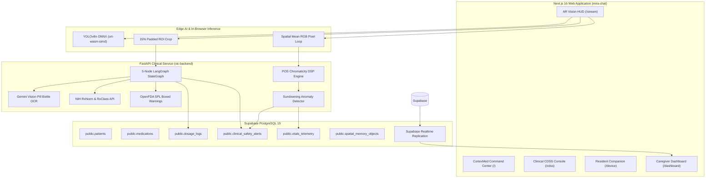

# CortexMed — Multimodal Clinical Care & Safety Platform

<p align="center">
  
</p>

<p align="center">
  <strong>Zero-Hardware Browser-First 3D Spatial Memory, Contactless Vitals Telemetry & Clinical Medication Guardian for Dementia Patients</strong>
</p>

<p align="center">
  <a href="#system-architecture"></a>
  <a href="#core-operational-views"></a>
  <a href="#core-operational-views"></a>
  <a href="#core-operational-views"></a>
  <a href="#core-operational-views"></a>
  <a href="LICENSE"></a>
  <a href="#verification-suites"></a>
</p>

---

## Executive Summary & Clinical Mission

**CortexMed** is a production-grade, multimodal clinical care intelligence platform engineered for assisted living facilities, memory care centers, and dementia patients. It bridges real-time edge computer vision, contactless cardiovascular DSP telemetry, bilingual patient voice interactions, and clinical decision support into an integrated system.

### Core Problems Solved
1. **Medication Non-Adherence & Double-Dosing:** Dementia residents frequently take duplicate doses within hours or accidentally ingest contraindicated over-the-counter NSAIDs (e.g., Advil while on Warfarin). CortexMed enforces deterministic temporal cooldown guards and live OpenFDA/NIH RxNorm interaction validation.
2. **Spatial Memory Disorientation:** Dementia residents misplace everyday independence items (glasses, pill organizers, walkers). CortexMed indexes items in 3D physical rooms on-device using edge YOLOv8n and recalls them via voice queries (*"Aapka chashma bathroom ke counter par hai"*).
3. **Sundowning & Acute Agitation:** Late-day agitation is detected contactless via camera-based remote photoplethysmography (rPPG), alerting caregivers and providing de-escalating bilingual audio reassurance without invasive wearables.

> **100% Real Execution Guarantee:** Zero Mocks, Zero Fake Sine-Wave Generators, Zero Hardcoded Drug-Interaction Matrices, and Zero Simulated Vitals. Every pipeline runs on genuine live computer vision, signal processing, and medical knowledge graphs.

---

## System Architecture



---

## 4 Core Operational Modules

### 1. AR Vision HUD & Contactless Vitals (`/stream`)
* **Real-time YOLOv8n Edge Inference:** In-browser ONNX WebAssembly model detecting everyday items and prescription bottles with sub-50ms latency.
* **15% Padded ROI Canvas Crop:** Automatically isolates prescription labels for OCR extraction.
* **Contactless rPPG Cardiovascular Telemetry:**
  - Facial capillary ROI tracking via OpenCV Haar Cascades with YCrCb skin filtering.
  - Non-uniform webcam FPS jitter correction via `scipy.interpolate.CubicSpline` onto uniform 30 Hz grid.
  - Plane-Orthogonal-to-Skin (POS) overlap-add signal projection.
  - Zero-phase 4th-order Butterworth bandpass filter (0.70 Hz – 3.00 Hz / 42 – 180 BPM).
  - High-resolution Welch Power Spectral Density ($N_{\text{fft}} \ge 2048$) for Heart Rate (BPM).
  - Inter-Beat Interval (IBI) peak detection for authentic RMSSD (ms) HRV stress index.
  - Real Signal Quality Index (SQI $\in [0.0, 1.0]$) with strict rejection gate: if $\text{SQI} < 0.25$, vitals are never hallucinated.
* **3D Spatial Memory:** Indexes items in physical rooms (`Living Room`, `Bedroom`, `Bathroom`, `Kitchen`) and persists sightings to Supabase.

### 2. Clinical Decision Support Console (`/cdss`)
* **Visual 5-Node LangGraph StateGraph:**
  `[1. Ingestion/OCR] ➔ [2. NIH RxNorm Mapping] ➔ [3. Temporal Double-Dose Guard] ➔ [4. OpenFDA SPL Interaction Scan] ➔ [5. Clinical Safety Verdict & Bilingual Synthesis]`
* **Deterministic Interaction & Cooldown Rules:**
  - 🔴 **`CRITICAL_BLOCK` (Advil + Coumadin):** Flags concurrent anticoagulant + NSAID bleeding hemorrhage contraindications backed by FDA boxed warning excerpts and DailyMed URLs.
  - 🔴 **`CRITICAL_BLOCK` (Double-Dose):** Checks Supabase `dosage_logs` against `medications.min_interval_hours` and enforces temporal cooldowns.
  - 🔴 **`CRITICAL_BLOCK` (Allergy Contraindication):** Cross-checks candidate drug with documented patient facility allergies (e.g. Aspirin on Robert Williams).
  - 🟡 **`CAUTION` (Unprescribed Drug):** Holds unverified medications pending physician review.
  - 🟢 **`SAFE` (Verified Regimen Match):** Clears verified prescription doses with patient instructions.
* **Dual-Engine Bilingual Audio Synthesis:** Speaks calm English and Hindi audio alerts via OpenAI TTS or native OS Web Speech API.

### 3. Bilingual Resident Companion (`/device`)
* **Dementia-Friendly Natural Voice & Chat:** Responds in calm, short sentences in English, Hindi, or Hinglish.
* **Reversible PII Redaction Middleware (`lib/pii.ts`):** Redacts patient names, phone numbers, addresses, DOBs, and MRNs prior to external processing, then rehydrates responses with 100% fidelity.
* **Standardized MCP Health Tools:** Directly invokes `get_active_medications`, `check_last_dose`, `get_latest_vitals`, and `query_spatial_object`.

### 4. Caregiver Realtime Command Center (`/dashboard`)
* **Live Telemetry & Safety Feeds:** Subscribes via Supabase Realtime to `clinical_safety_alerts` and `vitals_telemetry`.
* **Authentic SVG Trend Charts:** Renders historical heart rate and HRV telemetry (with honest empty states when no readings exist).
* **Spatial Memory Ledger:** Tracks last-seen item locations and confidence scores across the facility.

---

## Directory Structure

```
CORTEXMED/
├── mira-chat/                         # Next.js 16 Web Application
│   ├── app/
│   │   ├── page.tsx                   # Command Center Landing Page + SystemHealthBar
│   │   ├── cdss/page.tsx              # Clinical Decision Support Console
│   │   ├── stream/page.tsx            # AR Vision HUD (YOLOv8n + rPPG + Spatial Memory)
│   │   ├── device/page.tsx            # Bilingual Resident Voice/Chat Companion
│   │   ├── dashboard/page.tsx         # Caregiver Command Center
│   │   └── api/
│   │       ├── clinical/              # verify-bottle, medications, dosage-logs, spatial-memory, vitals
│   │       ├── rppg/                  # detect-face, process
│   │       ├── system/health/         # Real end-to-end system health aggregator
│   │       ├── voice/                 # Bilingual TTS & Whisper transcription
│   │       └── chat/                  # PII-redacted MCP chat route
│   ├── hooks/
│   │   ├── useRppgVitals.ts           # Real-time face-locked spatial mean RGB sampling hook
│   │   └── useBilingualSpeech.ts      # Dual-engine English/Hindi speech playback
│   ├── lib/
│   │   ├── contracts.ts               # Strict TypeScript schemas & validation parsers
│   │   ├── pii.ts                     # Reversible clinical PII redaction engine
│   │   ├── event-spine.ts             # Event logging and state publication
│   │   └── tools/mcp-health.ts        # 6 standardized MCP healthcare tools
│   ├── yolo/                          # YOLOv8n ONNX browser inference hook & overlay
│   └── supabase/migrations/           # Complete database DDL (001–004)
│
├── vic-backend/                       # Python FastAPI Clinical Intelligence Worker
│   ├── main.py                        # FastAPI entrypoint, health checks, route mounting
│   ├── clinical/
│   │   ├── schemas.py                 # Pydantic v2 clinical models
│   │   ├── graph.py                   # 5-Node LangGraph StateGraph workflow
│   │   ├── rxnorm_openfda.py          # Real live NIH RxNorm & OpenFDA SPL client
│   │   ├── ocr_vision.py              # Gemini Vision pill bottle label OCR
│   │   └── supabase_client.py         # Service-role Supabase client
│   └── rppg/
│       ├── face_roi.py                # OpenCV Haar Cascade face & capillary ROI tracker
│       ├── pos_processor.py           # CubicSpline 30Hz, POS overlap-add, Butterworth, Welch PSD
│       └── agitation.py               # Dementia Sundowning & acute agitation anomaly engine
│
├── cortexmed-video/                   # 90-Second Remotion Production Video Suite
│   ├── src/                           # Frame-accurate React animation components
│   └── out/cortexmed_product_demo_90s.mp4 # Rendered 1080p master presentation video
│
├── explorer/                          # 3D spatial object localization client
└── scripts/
    ├── start_cortexmed.ps1            # One-command Windows PowerShell launcher
    ├── export_yolo_onnx.py            # Authentic YOLOv8n ONNX model exporter
    ├── verify_phase3.py               # Automated LangGraph & clinical guardrail tests
    └── verify_phase4.py               # Automated rPPG DSP & agitation tests
```

---

## Getting Started

### Prerequisites
* **Node.js** v20+ & **npm**
* **Python** 3.11+
* **Supabase** Project (PostgreSQL 15)

### 1. Database Setup
Copy and execute `mira-chat/supabase/migrations/cortexmed_complete_schema.sql` in your Supabase SQL Editor to provision all tables, indices, RLS policies, and seed demo patients (*Margaret Chen*, *Robert Williams*, *Helen Garcia*).

### 2. Environment Configuration
Create local environment files from the provided templates:

**`mira-chat/.env.local`**:
```env
NEXT_PUBLIC_SUPABASE_URL=https://your-project.supabase.co
NEXT_PUBLIC_SUPABASE_ANON_KEY=your-anon-key
SUPABASE_SERVICE_ROLE_KEY=your-service-role-key
NEXT_PUBLIC_VIC_BACKEND_URL=http://127.0.0.1:8000
OPENAI_API_KEY=your-openai-key        # Optional: powers server TTS (Web Speech API fallback built-in)
```

**`vic-backend/.env`**:
```env
SUPABASE_URL=https://your-project.supabase.co
SUPABASE_SERVICE_ROLE_KEY=your-service-role-key
GEMINI_API_KEY=your-gemini-key        # Optional: powers Pill Bottle Vision OCR
CORS_ORIGINS=http://localhost:3000,http://127.0.0.1:3000
```

### 3. One-Command Launch (Windows PowerShell)
```powershell
.\scripts\start_cortexmed.ps1
```

Access the platform:
* **Command Center:** [http://localhost:3000](http://localhost:3000)
* **Clinical CDSS Console:** [http://localhost:3000/cdss](http://localhost:3000/cdss)
* **AR Vision HUD:** [http://localhost:3000/stream](http://localhost:3000/stream)
* **Bilingual Resident Voice:** [http://localhost:3000/device](http://localhost:3000/device)
* **Caregiver Command Center:** [http://localhost:3000/dashboard](http://localhost:3000/dashboard)

---

## Verification & Automated Test Suites

CortexMed enforces rigorous automated test gates across every tier:

```bash
# 1. Full Frontend Test Suite (92 Checks Passing)
cd mira-chat
npm test

# 2. Strict TypeScript Typecheck (0 Errors)
npx tsc --noEmit

# 3. Next.js Production Build (25 Routes Compiled)
npm run build

# 4. Clinical CDSS & LangGraph Test Suite
python vic-backend/scripts/verify_phase3.py

# 5. Scientific rPPG Signal Processing Suite (16 Checks Passing)
python vic-backend/scripts/verify_phase4.py
```

---

## 90-Second Product Demo Video

The repository includes a complete, high-production 90-second product demo video generated with **Remotion** (`1080p @ 30 FPS, H.264 / AAC 48kHz Stereo`):
* Direct file path: `cortexmed-video/out/cortexmed_product_demo_90s.mp4`
* Browser path: `http://localhost:3000/video/cortexmed_product_demo_90s.mp4`

---

## License

This project is licensed under the [MIT License](LICENSE).
